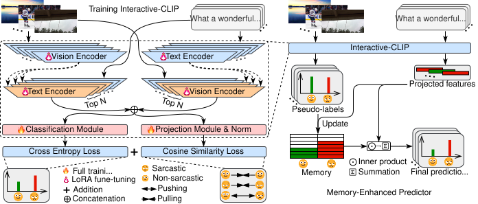
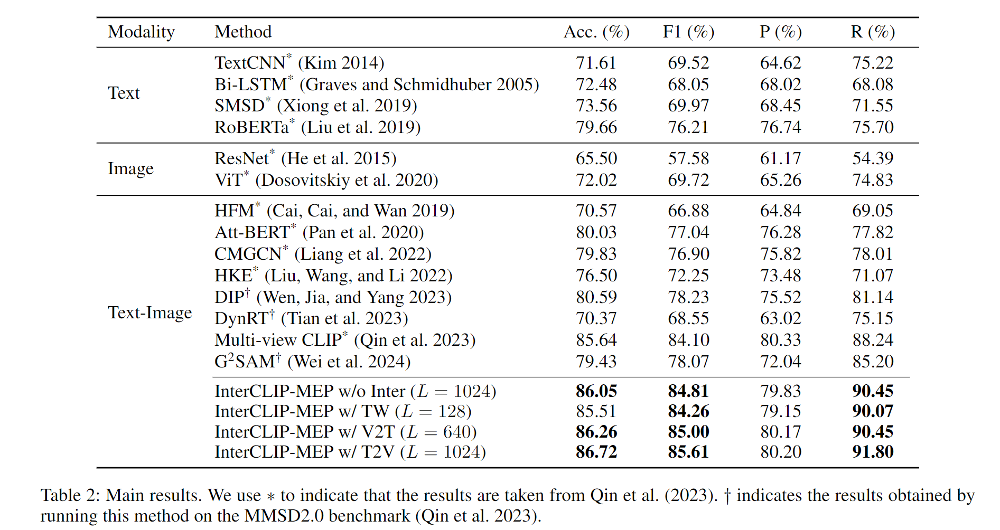
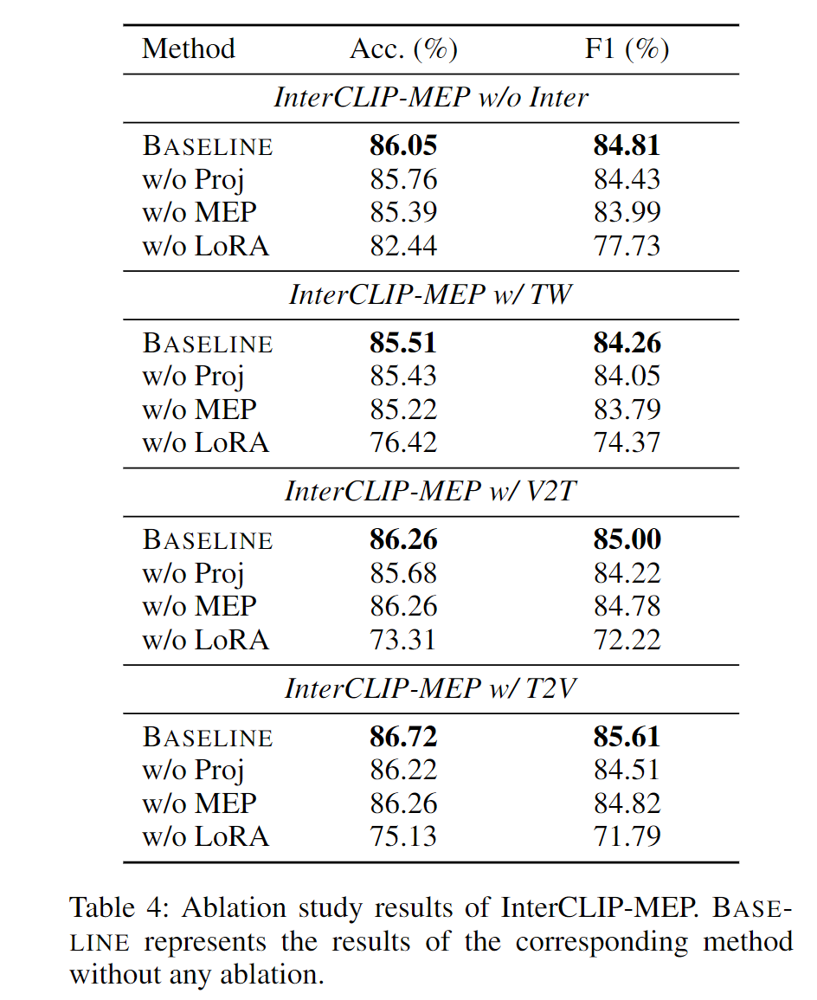
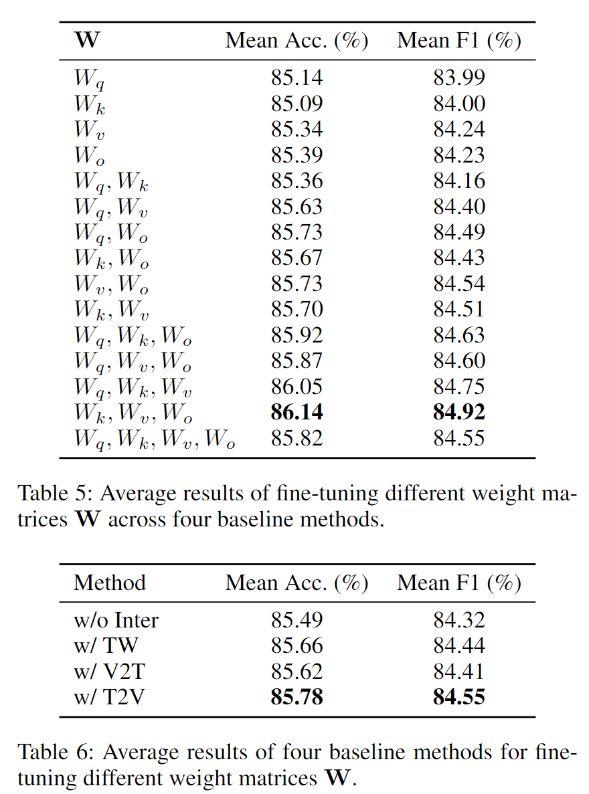
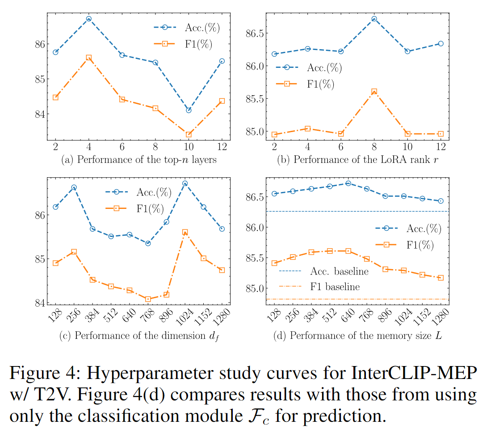

# [ACM TOMM] InterCLIP-MEP: Interactive CLIP and Memory-Enhanced Predictor for Multi-modal Sarcasm Detection

---
[](https://arxiv.org/abs/2406.16464)

<a href="https://www.junjie-chen.info">Junjie Chen<sup>1</sup></a>, <a href="https://scholar.google.com/citations?user=3BLeGSoAAAAJ&hl">Hang Yu<sup>2†</sup></a>, Subin Huang<sup>1‡</sup>, Sanmin Liu<sup>1</sup>, <a href="http://www.zhanglinfeng.tech/">Linfeng Zhang<sup>3</sup></a>

1 Anhui Polytechnic University<span style="margin-left: 10px;"></span> 
2 Shanghai University<span style="margin-left: 10px;"></span> 
3 Shanghai Jiao Tong University

† Co-corresponding author<span style="margin-left: 10px;"></span> 
‡ Corresponding author<span style="margin-left: 10px;"></span> 

---

## 📄Abstract

Sarcasm in social media, frequently conveyed through the interplay of text and images, presents significant challenges for sentiment analysis and intention mining. Existing multi-modal sarcasm detection approaches have been shown to excessively depend on superficial cues within the textual modality, exhibiting limited capability to accurately discern sarcasm through subtle text-image interactions. To address this limitation, a novel framework, InterCLIP-MEP, is proposed. This framework integrates Interactive CLIP (InterCLIP), which employs an efficient training strategy to derive enriched cross-modal representations by embedding inter-modal information directly into each encoder, while using approximately 20.6× fewer trainable parameters compared with existing state-of-the-art (SOTA) methods. Furthermore, a Memory-Enhanced Predictor (MEP) is introduced, featuring a dynamic dual-channel memory mechanism that captures and retains valuable knowledge from test samples during inference, serving as a non-parametric classifier to enhance sarcasm detection robustness. Extensive experiments on MMSD, MMSD2.0, and DocMSU show that InterCLIP-MEP achieves SOTA performance, specifically improving accuracy by 1.08% and F1 score by 1.51% on MMSD2.0. Under distributional shift evaluation, it attains 73.96% accuracy, exceeding its memory-free variant by nearly 10% and the previous SOTA by over 15%, demonstrating superior stability and adaptability. The implementation of InterCLIP-MEP is publicly available at https://github.com/CoderChen01/InterCLIP-MEP.

<center>

</center>

## ℹ️Installation

### Virtual Environment

We use [`pyenv`](https://github.com/pyenv) to manage the Python environment.

If you haven't installed `Python 3.9`, please run the following command:

```bash
pyenv install 3.9
```

> Note: pyenv will try its best to download and compile the wanted Python version, but sometimes compilation fails because of unmet system dependencies, or compilation succeeds but the new Python version exhibits weird failures at runtime. (ref: https://github.com/pyenv/pyenv/wiki#suggested-build-environment)

Then, create a virtual environment with the following command:

```bash
pyenv virtualenv 3.9.19 mmsd-3.9.19
```

Finally, activate the virtual environment:

```bash
pyenv activate mmsd-3.9.19
```

You can also create the virtual environment in any way you prefer.

### Dependencies

We use [`poetry`](https://python-poetry.org/) to manage the dependencies. Please install it first.

Then, install the dependencies with the following command:

```bash
poetry install
```

## ⚠️Dataset preprocessing

We use [datasets](https://huggingface.co/docs/datasets/en/index) library to read the dataset.

Therefore, we provide a script [convert_mmsd2_to_imagefolder_data.py](./scripts/convert_mmsd2_to_imagefolder_data.py) to convert MMSD2.0 into a format readable by the Hugging Face datasets library and upload it to Hugging Face.
Please follow the instructions in [MMSD2.0](https://github.com/JoeYing1019/MMSD2.0?tab=readme-ov-file) to prepare the data.

Then, modify line 12 in [convert_mmsd2_to_imagefolder_data.py](./scripts/convert_mmsd2_to_imagefolder_data.py) to specify the dataset path. Next, change lines 109-110 to the name of the dataset you wish to upload to Hugging Face (before doing this, you must first login using `huggingface-cli`, for details see: https://huggingface.co/docs/datasets/en/upload_dataset#upload-with-python).
Afterwards, run the script `python scripts/convert_mmsd2_to_imagefolder_data.py`.

To use the OpenCLIP checkpoint, you need to directly run `scripts/openclip2interclip.py`.

Finally, you need to specify the name of the dataset you uploaded and some necessary paths in all config files.

## ⚗️Reproduce Results

[](https://huggingface.co/datasets/coderchen01/MMSD2.0/)

```shell
# Main results
./scripts/run_main_results-clip-base-MMSD.sh
./scripts/run_main_results-clip-base-MMSD2.0.sh
./scripts/run_main_results-clip-roberta-MMSD.sh
./scripts/run_main_results-clip-roberta-MMSD2.0.sh
```

<details>
<summary>Click to see the results</summary>
<center>

</center>
</details>

```shell
# Ablation study
./scripts/run_ablation_study.sh
```

<details>
<summary>Click to see the results</summary>
<center>

</center>
</details>

```shell
# LoRA analysis
./scripts/run_lora_analysis.sh
```

<details>
<summary>Click to see the results</summary>
<center>

</center>
</details>

```shell
# Hyperparameter study for InterCLIP-MEP w/ T2V
./scripts/run_hyperparam_study.sh
```

<details>
<summary>Click to see the results</summary>
<center>

</center>
</details>

## 🤗Acknowledgement

- [Hugging Face](https://huggingface.co/)
- [CLIP](https://github.com/openai/CLIP)
- [OpenCLIP](https://github.com/mlfoundations/open_clip)
- [MMSD2.0 benchmark](https://github.com/JoeYing1019/MMSD2.0?tab=readme-ov-file)
- [MMSD benchmark](https://github.com/wrk226/pytorch-multimodal_sarcasm_detection)

## 📃Reference

If you find this project useful for your research, please consider citing the following paper:

```bibtex
@misc{chen2024interclipmep,
      title={InterCLIP-MEP: Interactive CLIP and Memory-Enhanced Predictor for Multi-modal Sarcasm Detection}, 
      author={Junjie Chen and Hang Yu and Subin Huang and Sanmin Liu and Linfeng Zhang},
      year={2024},
      eprint={2406.16464},
      archivePrefix={arXiv},
      primaryClass={cs.CL},
      url={https://arxiv.org/abs/2406.16464}, 
}
```

## 📝License

See the [LICENSE](./LICENSE.md) file for license rights and limitations (MIT).

## 📧Contact

If you have any questions about our work, please do not hesitate to contact [Junjie Chen](mailto:jorji.chen@gmail.com).
